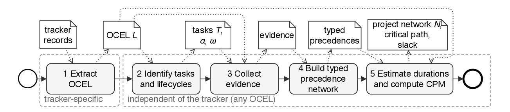
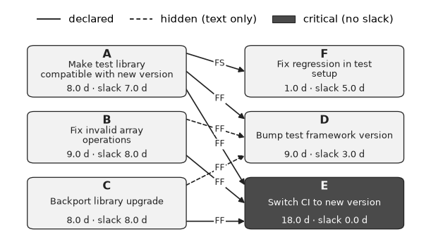
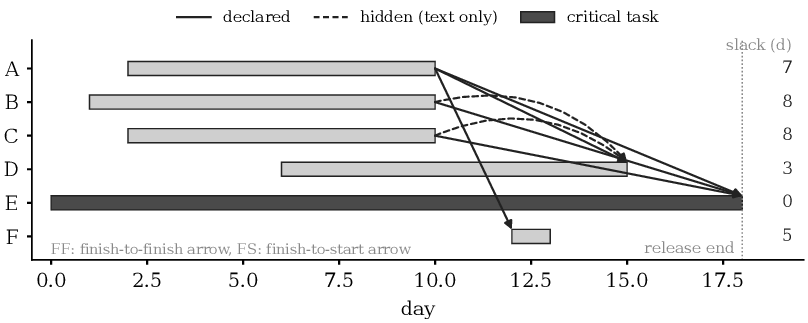
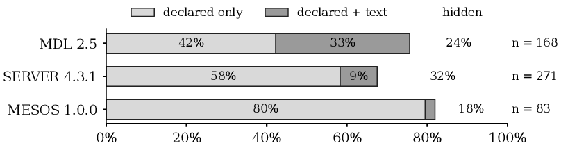

# Object-Centric Project Mining: reproducibility package

Reproducibility package for the paper *Object-Centric Project Mining:
Recovering the Hidden PERT from Agile Issue Trackers* (AI-PA 2026, under review).

Agile teams do not draw PERT charts, but their issue trackers contain one.
Object-centric project mining recovers it: from an object-centric event log
(OCEL 2.0) of an issue tracker, it derives the **project network of a release**:
tasks, typed precedence relations (finish-to-start FS, start-to-start SS,
finish-to-finish FF, start-to-finish SF), duration distributions, critical path,
and slack. Precedence is supported by three kinds of evidence: declared links
(E1), relations between objects such as a shared epic (E2), and statements in
titles, descriptions, and comments, extracted by an LLM that must quote its
source (E3). Types are assigned by the observed execution.



## Guided tour (notebook)

[**Open the guided tour: `notebooks/project_mining_tour.ipynb`**](notebooks/project_mining_tour.ipynb)

The notebook shows the technique step by step and compares it with
object-centric process mining on the same data. It is stored with all outputs,
so it can be read directly on this page without installing anything:

1. the running example of the paper as an OCEL;
2. object-centric process mining: the directly-follows graph, and why it cannot
   show which task waited for which;
3. object-centric project mining: the mined precedences with their evidence,
   the PERT chart, and the Gantt chart;
4. a real release, Apache Mesos 1.0.0, in both views;
5. what project mining adds to process mining.



To run it yourself, install the requirements (see the quickstart) and open it
with `.venv/bin/jupyter lab notebooks/project_mining_tour.ipynb`, or in VS Code
with the virtual environment as kernel.

## Quickstart: no download, one minute

```sh
python3 -m venv .venv && .venv/bin/pip install -r requirements.txt
cd code
../.venv/bin/python running_example.py   # the running example of the paper (Table 1)
../.venv/bin/python demo.py              # a real release: MESOS 1.0.0 from data-sample/
```

`running_example.py` builds the OCEL of the paper's running example and mines
its network (output summarized):

```text
A -> E  FF  declared       B -> D  FF  hidden (only comment c1 states it)
B -> E  FF  declared       C -> D  FF  hidden
C -> E  FF  declared       dropped F -> D (link added and removed)
A -> D  FF  declared       dropped E -> D (E finished after D)
A -> F  FS  declared       realized slack: E 0 (critical), D 3, F 5, A 7, B 8, C 8 days
```



`demo.py` mines release 1.0.0 of Apache Mesos (596 tasks) from a 4.6 MB OCEL in
`data-sample/` and reports, among others:

```text
Mined precedences: 83 (71 FF, 12 FS), 15 hidden (stated only in text)
Longest chain:
  MESOS-3648   Port stout/duration.hpp to Windows
  MESOS-3647   Port process/time.hpp to Windows
  MESOS-3646   Port process/clock.hpp to Windows
  MESOS-3637   Port process/process.hpp to Windows
  MESOS-3634   Port process/protobuf.hpp
Hidden dependencies (first 5):
  MESOS-4090 -> MESOS-5233 [FS]  "After MESOS-4090, all native code is move out of {{src/python/native}}."
  ...
```

Textual evidence comes from the cached LLM answers in `results/e3/`, so neither
script needs an API key.

## Key results

Evaluated on four Jira tracker projects of the TAWOS dataset (152,000 issues,
2.2 million events) and the Public Jira Dataset:

- **Declared dependencies hold as finish-to-finish rather than finish-to-start.**
  Of the declared links in 87 releases of Moodle, MongoDB, and Apache Mesos,
  78%, 91%, and 60% hold as FF, but only 31%, 40%, and 10% of those whose
  dependent task has a recorded start hold as FS. Over 84,336 block and depend
  links in 16 public Jira repositories: 76% FF, 31% FS.
- **Declarations are late and change.** 17-44% of the links were added after
  the dependent task had started, and 6-8% were later removed.
- **Many dependencies are hidden.** 18-32% of the mined dependencies of three
  releases are stated only in text, e.g., *"This ticket is unblocked"*. In a
  manual check of 30 randomly sampled ones, 28 quotes state an order between
  the two tasks.
- **Planned dependencies (RQ1).** Against 214 planned (Gantt) dependencies in 42
  epics of LSST Data Management:

  | Variant | Evidence | Precision | Recall | F1 |
  |---|---|---|---|---|
  | B1 | declared links | 0.00 | 0.00 | - |
  | Textual | E3 (quote-checked LLM) | 0.31 | 0.25 | 0.28 |
  | Full technique | E1-E3 | 0.24 | 0.25 | 0.25 |
  | B2 | LLM without evidence | 0.30 | 0.42 | 0.35 |

  B1 recovers none of them because DM connects a pair of tasks either by a
  typed (planned) or by a declared link, never both. B2 guesses dependencies
  from task names and types all of them FS. The technique accepts a dependency
  only with a link or a quote and types it by execution: 14 of 23 recovered
  planned FS dependencies were executed as FF.



## Contents

| Path | Content | Paper |
|---|---|---|
| `docs/ocel-mapping.md` | Mapping of tracker concepts to OCEL elements (Jira, GitHub, Redmine) | Step 1 |
| `prompts/e3-dependency.txt` | Prompt for textual evidence (E3) | Step 3 |
| `code/tawos_to_ocel.py` | Step 1: Jira (TAWOS) records to OCEL 2.0 (SQLite) | Sect. 3.2 |
| `code/mining.py` | Steps 2-5: tasks and lifecycles, evidence, typed network, durations, CPM | Sect. 3.2 |
| `code/e3_llm.py` | E3: LLM-extracted, quote-checked textual evidence; LLM proposals (B2) | Sect. 3.2, 4 |
| `code/running_example.py` | Running example (Table 1) as an OCEL, mined | Sect. 4.2 |
| `code/eval_rq1.py` | RQ1: recovery of planned dependencies in DM epics | Sect. 4.3, Table 3 |
| `code/eval_rq2.py` | RQ2: findings on released versions of MDL, SERVER, MESOS | Sect. 4.4 |
| `code/profiles.py` | Evidence profiles and validation sample | Fig. 3, Sect. 4.4 |
| `code/fig_example.py` | Running example figure | Fig. 2 |
| `code/start_signals.py`, `code/start_fallback.py` | Missing and late task starts | Step 2, Sect. 4.1 |
| `code/pert_link_checks.py` | FS/FF behaviour of links in the Public Jira Dataset | Sect. 4.4 |
| `code/eval_f5.py` | Slip analysis (not robust; discussed in Sect. 5) | Sect. 5 |
| `code/load_tawos.py`, `code/build_events.sql`, `code/load_jira_public.py` | Data loading | Sect. 4.1 |
| `code/data_checks.py`, `code/multi_object_events.py`, `code/find_example.py`, `code/show_cluster.py`, `code/remote_zip.py` | Exploration and helpers | - |
| `code/demo.py` | Report on a real release from the sample OCEL | - |
| `code/views.py` | Directly-follows graph, PERT chart, and Gantt chart of a mined network | Def. 2, Fig. 2 |
| `notebooks/project_mining_tour.ipynb` | Guided tour: process mining vs. project mining, PERT charts | Sect. 3, 4.2, 5 |
| `code/make_sample.py` | Cuts the sample OCEL out of a full OCEL | - |
| `data-sample/` | OCEL of MESOS 1.0.0 (4.6 MB), derived from TAWOS | - |
| `docs/img/` | Figures used in this README | - |
| `results/` | All results reported in the paper (CSV/JSON), LLM answers in `results/e3/` | Sect. 4 |

The datasets are not included; see below for how to obtain them.

## Results in the paper

| Paper | File |
|---|---|
| Table 2 (data) | `results/rq2/releases.csv`, OCEL statistics from `code/tawos_to_ocel.py` |
| Table 3 (RQ1) | `results/rq1/summary.csv` (variants `B1`, `E3-mention`, `FULL-mention`, `B2`; hybrid variants `E3`, `FULL`), per epic: `results/rq1/per_epic.csv`, edges: `results/rq1/edges.csv` |
| Sect. 4.4 (RQ2) | `results/rq2/edges.csv` (per declared link: `fs_ok`, `ff_ok`, added after start, removed), `results/rq2/tasks.csv`, `results/rq2/summary.csv`. The FS shares in the paper count only links whose dependent task has a recorded start (`fs_ok` not empty). |
| Fig. 3, hidden dependencies | `results/rq2/profiles.csv`; manual validation: `results/rq2/hidden_sample.csv` (column `valid`) |
| Running example | `results/running_example.json` |
| LLM answers and token usage | `results/e3/*.jsonl`, `results/e3/proposals/*.json`, `results/e3/usage.jsonl` |

All LLM answers are cached, so every script reproduces the reported numbers
without new API calls.

## Data

- **TAWOS** (Tawosi et al., MSR 2022): figshare article 21308124, file
  `TAWOS.sql.zip`, Apache 2.0. Place it in `data/raw/`.
- **Public Jira Dataset** (Montgomery et al., MSR 2022): Zenodo record
  15719919, CC-BY 4.0. Place the archive in `data/raw/jira-public/`.

## Setup

Python 3.10 or later.

```sh
python3 -m venv .venv && .venv/bin/pip install -r requirements.txt
```

## Reproducing

```sh
cd code
# data (about 30 minutes)
../.venv/bin/python load_tawos.py                 # data/tawos.sqlite
sqlite3 ../data/tawos.sqlite < build_events.sql
../.venv/bin/python load_jira_public.py           # data/jira_public.sqlite (Sect. 4.4, 84,000 links)

# Step 1: OCELs (seconds per tracker project)
../.venv/bin/python tawos_to_ocel.py MDL DM SERVER MESOS     # data/ocel/<KEY>.sqlite

# evaluation (uses the cached LLM answers in results/e3/)
../.venv/bin/python running_example.py            # Sect. 4.2
../.venv/bin/python fig_example.py                # Fig. 2
../.venv/bin/python eval_rq1.py                   # Sect. 4.3, Table 3
../.venv/bin/python eval_rq2.py                   # Sect. 4.4 (about 10 minutes)
../.venv/bin/python profiles.py                   # Fig. 3
../.venv/bin/python pert_link_checks.py           # Sect. 4.4, Public Jira Dataset
../.venv/bin/python start_signals.py              # Step 2, missing starts
```

### Querying the LLM again

E3 and B2 use an LLM with structured output. Answers already in `results/e3/`
are reused; only missing pairs are queried.

```sh
export E3_PROVIDER=openai                  # or: anthropic
export E3_MODEL=gpt-5.4-mini-2026-03-17    # model used in the paper
export E3_EFFORT=low
export OPENAI_API_KEY=...                  # or ANTHROPIC_API_KEY
../.venv/bin/python running_example.py --llm
../.venv/bin/python eval_rq1.py --llm
../.venv/bin/python eval_rq2.py MDL:2.5 SERVER:4.3.1 MESOS:1.0.0
```

The paper's run used 1,859 requests and cost less than US$5.

## Parameters

Defined at the top of `code/mining.py`: evidence weights (declared 1, removed
link -1, structural 0.25 up to 0.5), threshold 0.5, hand-over window 3 days,
minimum reference class size 10, 1,000 duration samples. Statuses of the
in-progress category per tracker project: `IN_PROGRESS` in `code/tawos_to_ocel.py`.

## License

Code: MIT (see `LICENSE`). The datasets keep their own licenses (TAWOS: Apache 2.0,
Public Jira Dataset: CC-BY 4.0); LLM answers in `results/e3/` quote issue texts
from these datasets.
